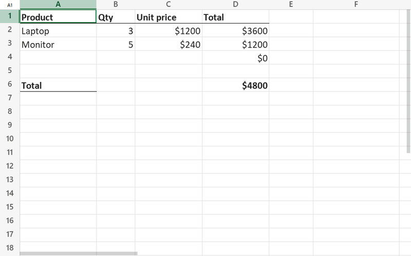

# @universal-office/sheet

The `<universal-sheet>` web component — an **.xlsx editor** that draws the grid
to a **canvas** with the look of Microsoft Excel: column widths and row heights
from the workbook, number formats, fonts, borders, merged cells, conditional
formatting, charts, images and shapes. Formulas are recalculated by a built-in
engine with Excel's functions.



- Opens .xlsx and .xls (Excel 97–2003, converted in memory); saves .xlsx,
  rewriting only what was edited
- Inline cell editing typed like Excel (numbers, dates, percentages, currency,
  booleans, formulas) with function autocomplete
- Recalculation of dependent cells across all sheets on every edit
- Formula language and number separators follow the user's locale
  (`=SUM(A1,1.5)` or `=SOMA(A1;1,5)`)
- Range selection, undo/redo, copy and paste (formulas adjusted), fill
  down/right, find and replace
- Formatting saved to the .xlsx: font, fill, borders, alignment, wrap, number
  formats, merge cells, column widths and row heights, hide/unhide, frozen
  panes, gridlines
- Optional built-in bars, like Excel: a compact toolbar (default) or a
  ribbon, formula bar, sheet tabs and a status bar with sum/average/count;
  English, Portuguese and Spanish UI; light and dark
- Frozen panes, hidden rows/columns, hyperlinks, comments
- Zoom, resizable rows and columns (double-click to autofit)

Just want to edit spreadsheets? The same editor is **Universal Sheet (Beta)** in the
ready-to-run desktop app **Universal Office (Beta)** — Write, Sheet and Slides in
one install — for Windows, macOS and Linux:
[download it from the releases page](https://github.com/erichideyuki/universal-office/releases/tag/v0.9.2).

## Installation

```bash
npm install @universal-office/sheet
```

All the code is inside the package; its only dependency is
`@universal-office/font-files` (pinned to an exact version), the open fonts. Serve these
paths:

| Path | What it is |
|---|---|
| `index.js` | The component (registers `<universal-sheet>` on import) |
| `chunks/` | Parts loaded on demand (the built-in bars, PDF export) |
| `@universal-office/font-files` | Open fonts used as metric-compatible substitutes (see [Fonts](#fonts)) |

```js
import { FontResolver } from '@universal-office/sheet';

FontResolver.shared().configure({ baseUrl: '/node_modules/@universal-office/font-files' });

const sheet = document.querySelector('universal-sheet');
sheet.loadXlsx(new Uint8Array(await (await fetch('/budget.xlsx')).arrayBuffer()));
sheet.addEventListener('us-selection', (e) => console.log(e.detail.ref, e.detail.edit));
```

```html
<universal-sheet style="display:block; height:100vh"></universal-sheet>
```

Give the element a size with CSS — it fills its box. For a complete
spreadsheet app with menus, formula bar and sheet tabs, add the bars:

```html
<universal-sheet topbar bottombar style="display:block; height:100vh"></universal-sheet>
```

## Attributes and properties

| Attribute / property | Description |
|---|---|
| `formula-locale` / `formulaLocale` | Locale of formulas and numbers (BCP 47). `pt*` uses Portuguese function names, errors and booleans (`=SOMA`, `#N/D`, `VERDADEIRO`); anything else uses English (`=SUM`, `#N/A`, `TRUE`). The decimal separator comes from the region; the argument separator is `;` when the decimal is `,`. Default: the browser's language. |
| `lang` | UI language (`en` · `pt` · `es`; any region: `es-MX`, `es-419`… → Spanish) of the component and its bars. Without it: the first of Spanish/Portuguese/English the browser prefers (`es-*` → Spanish, `pt-*` → Portuguese), otherwise English. It does not change the formulas: function names follow `formula-locale`, which has Portuguese and English names only (`formula-locale="es-ES"` keeps English names with the Spanish separators: `=SUM(A1;1,5)`). |
| `topbar` | Built-in top bar: title, menus, tools and the formula bar (see [Built-in bars](#built-in-bars)). |
| `toolbar` | `compact` (default — title above the File · Edit · View · Insert · Format · Tools · Help menus and one toolbar row that collapses by priority, like Google Sheets) or `ribbon` (File · Home · Insert · Formulas · View · Help tabs, like Excel). |
| `bottombar` | Built-in sheet tabs and status bar (sum, average, count of the selection; zoom). |
| `theme` | `auto` (default) · `light` · `dark`. Without it the bars follow the CSS `color-scheme` the element inherits; `light`/`dark` force it. The grid stays light, like Excel's. |
| `accent` | `green` (default) · `teal` · `blue` · `amber` · `red` · `purple` · `neutral`: the element's own palette for the bars and the selection (used even when the page has `--u-color-*` tokens). |
| `storage-key` | Remembers this instance's bar choices (toolbar style, formula bar, sheet tabs, theme, accent) in `localStorage`. Falls back to `id`; with neither, choices last only for the session. |
| `hidden-commands` / `hiddenCommands` | Commands, menus, groups, tabs and bar controls to hide (comma- or space-separated), everywhere: bars, menus, context menu and shortcuts — like the Write's. Example: `hidden-commands="file title save print sheet:insert"`. |
| `nofiledrop` | The bars never open dropped files (the cancelable `us-file-drop` still fires). |
| `nounloadprompt` | No browser "leave page?" prompt for unsaved changes. |
| `host` | Optional integration with the host app (Electron): native dialogs, OS fonts, close confirmation, window controls (see [Host integration](#host-integration)). |
| `fileName` | File name reported by `CELL("filename")`. Set before loading (the bars set it from the title). |
| `shouldRecalcOnOpen` | `(workbook) => boolean`. Return `true` to recalculate everything on open; otherwise the values saved in the file are shown, like Excel. |
| `onSelectionChange` | Callback form of `us-selection`. |
| `activeCellEditText` | What a formula bar should show for the active cell. |
| `effectiveTheme` | `'light'` · `'dark'`: the theme in effect (see `us-theme-change`). |

## Built-in bars

`topbar` and `bottombar` turn the element into a complete spreadsheet app —
nothing to wire. The bars are a chunk loaded on demand: without the attributes
the element loads none of it and looks exactly as before. They are built with
the same toolbar framework as `<universal-write>` (`@universal-office/ui`), so
both products share menus, dialogs, keyboard handling, colors and plugins.

- **Compact** (`toolbar="compact"`, default): the workbook title above the
  menus (editable — it is the name suggested when saving), a **Save .xlsx**
  button, and one toolbar row — undo, redo, print, zoom, currency, percent,
  decimals, number formats, font, size, bold, italic, strikethrough, font
  color, fill color, borders, merge, alignment, wrap, AutoSum; when space runs
  out the lowest-priority groups collapse into their own buttons and then into
  "⋮", and the menus into "☰".
- **Ribbon** (`toolbar="ribbon"`): quick access toolbar (save, undo, redo),
  File menu and the **Home** tab (Clipboard, Font, Alignment, Number, Cells,
  Editing groups, with the Format Cells launchers), **Insert** (sheet,
  function, AutoSum), **Formulas** (Function Library, Calculate Now),
  **View** (formula bar, gridlines, sheet tabs, status bar, zoom, Freeze
  Panes, theme, accent, toolbar style) and **Help**.
- **Formula bar** under either bar: the Name Box (shows the selection; type a
  reference — `B12`, `A1:C5`, `Sheet2!A1` — and Enter to go there), the
  **fx** button (Insert Function) and the formula of the active cell with
  function autocomplete. View › Formula bar hides it.
- **Bottom bar** (`bottombar`): sheet tabs with previous/next and **+**
  (Insert Sheet), and the status bar with Average · Count · Sum of the
  selection (when two or more cells are selected, like Excel) and the zoom
  slider.
- Menus:
  - **File** — New, Open (.xlsx, .xlsm, .xls), Save, Save as, Download as PDF,
    OpenDocument Spreadsheet (.ods), CSV and TSV (active sheet), Web page,
    Markdown, XML Spreadsheet 2003; Print (a PDF of the workbook);
    Properties.
  - **Edit** — Undo, Redo, Cut, Copy, Paste, Paste values, Fill (down,
    right), Clear (all, formats, contents), Select all, Find, Replace, Go to.
  - **View** — Formula bar, Gridlines, Sheet tabs, Status bar, Freeze (panes
    at the active cell, top row, first column, unfreeze), Zoom, previous/next
    sheet, Theme, Accent color, Toolbar (compact or ribbon).
  - **Insert** — Sheet, Function, AutoSum (Sum, Average, Count numbers, Max,
    Min).
  - **Format** — Number (General, Number, Currency, Accounting, Short date,
    Long date, Time, Percentage, Fraction, Scientific, Text, More number
    formats…, Comma style, Percent style, Increase/Decrease decimal), Text
    (bold, italic, underline, strikethrough, bigger/smaller), Font color,
    Fill color, Alignment (horizontal, vertical, indent, wrap), Merge cells
    (merge & center, merge across, merge cells, unmerge), Borders (bottom,
    top, left, right, none, all, outside, thick outside), Rows and Columns
    (height/width, AutoFit, hide, unhide), Format Cells… (Number, Alignment,
    Font and Fill tabs), Clear formats.
  - **Tools** — Calculate now. **Help** — Keyboard shortcuts, About.
- Context menu on the grid (cut, copy, paste, paste values, insert function,
  clear, merge, rows, columns, Format Cells), drag and drop of a spreadsheet
  to open it, unsaved-changes prompt on leaving the page.
- A command whose API the element does not have stays hidden.

### Light and dark

Like `<universal-write>`: the bars follow the **CSS `color-scheme` of their
context** (it crosses the shadow DOM) and every color is a `--u-color-*` token
or a `light-dark()` color, so the switch is pure CSS and live; `theme` forces
it. Without `accent`, the bars use the page's `--u-color-*` tokens when it
defines them, otherwise the element's own palette (green). The grid stays
light, like Excel's.

CSS variables: `--us-font` (UI font), `--us-background` (one background for
the bars, formula bar, sheet tabs and status bar; default
`--u-color-surface-container-low`), `--uo-bar-bg`, `--uo-bar-container` (the
toolbar pill), `--uo-accent`, `--us-formula-font`. Parts: `topbar`,
`bottombar`, `toolbar`, `titlebar`, `menubar`, `toolrow`, `tabs`, `ribbon`,
`menu`, `popover`, `dialog`, `notice`, `formula-bar`, `sheet-tabs`,
`statusbar`.

### Host integration

What only the host application can do comes in through the optional
`sheet.host` object (an Electron shell, for example); without it the bars use
the browser (File System Access, downloads, a PDF window for printing,
`beforeunload`):

```js
sheet.host = {
  openFile: () => bridge.open(),              // → { name, bytes, path? } | null
  saveFile: (bytes, { name, saveAs, path }) => bridge.save(bytes, name, path), // → name | { name, path } | null
  exportFile: (kind, name, data) => bridge.export(kind, name, data),        // data() → bytes/text after the user picks
  print: ({ pdf, title }) => bridge.print(pdf, title),                      // system print dialog
  listFonts: bridge.listFonts, resolveFonts: bridge.resolveFonts,           // OS fonts
  setDirty: (dirty, name) => bridge.setDirty(dirty, name),                  // confirm on close
  onSaveBeforeClose: (cb) => bridge.onSaveBeforeClose(cb),
  closeWindow: () => bridge.close(),
  setTitleTheme: (dark, barColor) => bridge.setTitleTheme(dark, barColor),  // window buttons
  setTitle: (title) => { document.title = title; },
  windowControlsOverlay: true, // frameless window: reserve the OS window buttons, drag by the title row
};
```

`openWorkbook(sheet, bytes, name, { path })` (exported) opens a workbook the
way File › Open does: title, file name and, with `path`, where Save writes.
When the page saves and opens files itself, handle the cancelable
`us-save-request` (`detail: { saveAs, format }`) and `us-open-request` events
and call `preventDefault()`: the bars then do nothing for those actions.
`sheet.setNotice(element, { tone })` shows a notice band between the title
row and the tools (`tone`: `info` · `warning` · `error`; `null` removes it).

### Plugins

The same model as `<universal-write>`: install per instance with
`sheet.use(plugin)` / `sheet.unuse(id)`, or for every instance with
`UniversalSheetElement.register(plugin)` / `unregister(id)`. A plugin may
declare `setup({ sheet })` (returns its cleanup) and
`toolbar({ sheet, lang, theme, ui })`, returning commands and their places in
the bars — `{ commands, compact: { title, leading, menus, groups, trailing },
ribbon: { title, tabs, groups: [{ tab, … }], qat } }`; items accept
`before: '<id>'`. `ui` is the widget kit (`createBarButton`, `createBarIcon`,
`createBarRow`, `barCss`…), also available as `loadBarKit()`. Labels take a
string or `{ en, pt, es }`; `es` is optional, and without it the Spanish UI
shows the English text.

```js
sheet.use({
  id: 'acme.audit',
  toolbar: () => ({
    commands: [{ id: 'acme:audit', label: { en: 'Audit', pt: 'Auditar' }, icon: 'info', run: () => audit(sheet) }],
    compact: { groups: [{ id: 'acme', label: 'Acme', items: ['acme:audit'] }] },
    ribbon: { groups: [{ tab: 'home', id: 'acme', label: 'Acme', cells: [{ cmd: 'acme:audit', size: 'large' }] }] },
  }),
});
```

## Methods

| Method | Description |
|---|---|
| `loadXlsx(bytes: Uint8Array)` | Opens .xlsx or .xls on the workbook's active sheet. Throws on an invalid file. |
| `newWorkbook()` | A blank workbook (one sheet, `Sheet1`/`Planilha1`, Aptos Narrow 11). |
| `saveXlsx(): Uint8Array` | Commits any edit in progress and returns the .xlsx. Parts that were not edited are kept as they were. |
| `isDirty()` · `setDirty(v)` | Changed since loading (or since `setDirty(false)`, which the bars call after saving). |
| `getSheetNames()` · `selectSheet(i)` · `activeSheet` | Sheets (tabs). |
| `addSheet(name?)` | Inserts an empty sheet at the end and selects it; returns its name. (The workbook is rewritten and reopened: undo starts over.) |
| `goToRef('B12')` | Selects a cell. |
| `selectRange('B2:D8')` · `getSelection()` · `selectAll()` | Range selection (`'C:C'` columns, `'3:5'` rows, `'Sheet2!A1'`); `getSelection()` → `{ sheet, ref, range, col, row, c1, r1, c2, r2 }`. |
| `setZoom(z)` · `getZoom()` | Zoom, 0.4–3. |
| `setCellValue(col, row, text)` | Writes text as if typed (1-based column and row): `''` clears, `=…` is a formula. Returns `{ ok: true }` or `{ ok: false, message }`. |
| `setActiveCellText(text)` | Same, for the active cell (formula-bar commit; undoable). |
| `beginEdit(col, row, text?)` · `commitEdit()` · `cancelEdit()` | Inline editor. |
| `undo()` · `redo()` · `canUndo()` · `canRedo()` | Undo and redo of typing, pasting, clearing, filling, formatting, merging, sizes, hiding, freezing and gridlines (100 steps). |
| `copy()` · `cut()` · `paste(text?, { valuesOnly })` | The selection as tab-separated text (what goes to the clipboard); pasting inside the element brings formulas (relative references adjusted; a cut moves them unchanged) and formats; outside text becomes cells, as typed. |
| `fill('down' \| 'right')` · `clear('contents' \| 'formats' \| 'all')` | Fill down/right (formulas adjusted) and Clear. |
| `setFormat({ font, fill, border, align, numFmt })` | Formats the selection in one undo step: `font: { bold, italic, underline, strike, size, name, color }`, `fill: '#RRGGBB' \| null`, `align: { horizontal, vertical, wrapText, indent }`, `numFmt: 'percent' \| { code }`. Also `setFont`, `setAlignment`, `setNumberFormat`, `adjustDecimals(±1)`, `setBorders(kind)`. Whole columns/rows get the column/row style, like Excel. |
| `getCellFormat()` | Formatting of the active cell (font, fill, alignment, wrap, number format code, merged). |
| `merge('center' \| 'across' \| 'cells')` · `unmerge()` · `mergeLosesData()` | Merge cells (only the upper-left value is kept, like Excel). |
| `freezePanes(cols?, rows?)` · `frozenPanes` | Freeze panes (no arguments: at the active cell; `0, 0` unfreezes). |
| `showGridlines` | Gridlines on the active sheet (saved). |
| `columnWidth(col?)` · `setColumnWidth(w)` · `rowHeightPt(row?)` · `setRowHeight(pt)` · `autofitColumns()` · `autofitRows()` · `setHidden('cols' \| 'rows', hidden)` | Sizes (column width in characters, as Excel shows it; row height in points) and hide/unhide for the selection. |
| `find(query, opts)` · `replace(query, text, opts)` · `replaceAll(query, text, opts)` | Find (moves to the next match), Replace, Replace All (count). Options: `matchCase`, `wholeCell`, `lookIn: 'formulas' \| 'values'`, `allSheets`, `backwards`. |
| `autoSum(fn)` · `insertFunction(name)` · `getFunctionNames()` · `recalculate()` | AutoSum (`SUM`, `AVERAGE`, `COUNT`, `MAX`, `MIN`), Insert Function, Calculate Now. |
| `selectionStats()` | `{ cells, count, numericCount, sum, average, min, max }` of the selection. |
| `getProperties()` | Title, author, dates and application from docProps, and the sheet names. |
| `attachFormulaBar(input)` | Adds function autocomplete to your formula-bar `<input>`; returns a detach function. |
| `renderRegionToCanvas(sheet, canvas, cols, rows)` | Draws a range at 100% (no headers) — e.g. to export a PNG. |
| `drawingsReady(): Promise<void>` | Resolves when fonts, images and drawings are ready. |
| `use(plugin)` · `unuse(id)` · `setNotice(el, opts)` | Plugins and the notice band (see [Built-in bars](#built-in-bars)). |

A minimal formula bar of your own (the built-in one does this):

```js
const bar = document.querySelector('#formula');
sheet.attachFormulaBar(bar);
sheet.addEventListener('us-selection', () => { bar.value = sheet.activeCellEditText; });
bar.addEventListener('keydown', (e) => {
  if (e.key === 'Enter') sheet.setActiveCellText(bar.value);
});
```

## Events

| Event | `detail` | When |
|---|---|---|
| `us-selection` | `{ ref, range, display, formula, edit, ghost }` | The selected cell, range or sheet changed (also after edits). `ghost` = part of a spilled array. |
| `us-edit` | `{ ref, text }` | A cell was written. |
| `us-change` | `{ kind }` | The workbook changed (edit, format, resize, merge, view, undo…) — once per task. |
| `us-load` | `{ reload }` | A workbook was loaded (`reload`: `addSheet` reopened the same one). |
| `us-entry-error` | `{ message }` | Input was refused (invalid formula, part of an array) — Excel's message, in the formula language. |
| `us-zoom` | `{ zoom }` | Zoom changed. |
| `us-theme-change` | `{ theme }` | The effective light/dark theme changed. |
| `us-save-request` · `us-open-request` | `{ saveAs, format }` · `{}` | Cancelable: the bars are about to save/open (see [Host integration](#host-integration)). |
| `us-file-drop` | `{ files }` | Cancelable: files were dropped on the element (with `topbar`). |

## Fonts

The default font of a workbook (Aptos Narrow, Calibri…) defines the column
widths, so it matters. Families resolve, in order: fonts the browser can see
by name (installed or declared with `@font-face`) → **metric-compatible open
substitutes** from the folder given to `FontResolver` (Calibri → Carlito,
Cambria → Caladea, Arial → Liberation Sans, Times New Roman → Liberation
Serif, Courier New → Liberation Mono) → Liberation Sans. Those fonts come in
`@universal-office/font-files`, installed with this package: serve its folder
and point `FontResolver.shared().configure({ baseUrl })` at it. The PDF
export uses the workbook's Normal font when its file is available, otherwise
Liberation Sans.

## Keyboard and mouse

Arrows move (leaving merged cells by their edge), Shift+arrows extend the
selection, Ctrl+arrows jump to the edge of the data, Home · End go to the
first and last column, Ctrl+Home · Ctrl+End to A1 and the last used cell,
PageUp · PageDown move 10 rows, Tab · Shift+Tab move sideways, Ctrl+A selects
all, Ctrl+Space · Shift+Space the column · row, Ctrl+PageUp · Ctrl+PageDown
switch sheets. Typing starts editing, F2 or Enter edit the current content,
Delete · Backspace clear the selection, Ctrl+Z · Ctrl+Y undo and redo,
Ctrl+C · Ctrl+X · Ctrl+V copy, cut and paste. While editing: Enter commits and
moves down, Tab · Shift+Tab commit and move sideways, Escape cancels.
Click and drag (or Shift+click) select a range; click a column letter or row
number to select it (drag for several); the corner selects all. Wheel
scrolls (Shift for horizontal); drag a header border to resize, double-click
it to autofit; double-click a cell to edit; hover a red-cornered cell to read
its comment.

With `topbar`, Excel's shortcuts for the bar commands: Ctrl+O open, Ctrl+S
save, F12 save as, Ctrl+P print, Ctrl+F find, Ctrl+H replace, Ctrl+G · F5 go
to, Ctrl+B · I · U · 5 bold, italic, underline, strikethrough, Ctrl+1 Format
Cells, Ctrl+D · Ctrl+R fill down/right, Alt+= AutoSum, Shift+F3 insert
function, F9 calculate, Shift+F11 insert sheet, Ctrl+9 · Ctrl+0 hide rows ·
columns, Ctrl+Shift+9 unhide rows, Ctrl+Shift+1 · 2 · 3 · 4 · 5 · 6 number,
time, date, currency, percent, scientific formats, Ctrl+Shift+` General,
Ctrl+Shift+7 outside borders, Ctrl+Shift+- no border (keys by position, so
they work on any keyboard layout). Help › Keyboard shortcuts lists them all.

## Current limitations

Not yet available (and so not in the bars): inserting or deleting rows,
columns and cells; sorting and filtering; inserting charts, images, shapes,
comments and hyperlinks; editing conditional formatting, data validation and
cell styles; renaming, deleting and moving sheets; Paste Special beyond
values; page setup and print options (print and PDF use the converter's
layout); right-to-left editing (right-to-left sheets are drawn only by
`renderRegionToCanvas`); hiding the row and column headings.

## License

MIT. The fonts (`@universal-office/font-files`) are under the SIL OFL 1.1
and the Apache License 2.0.
