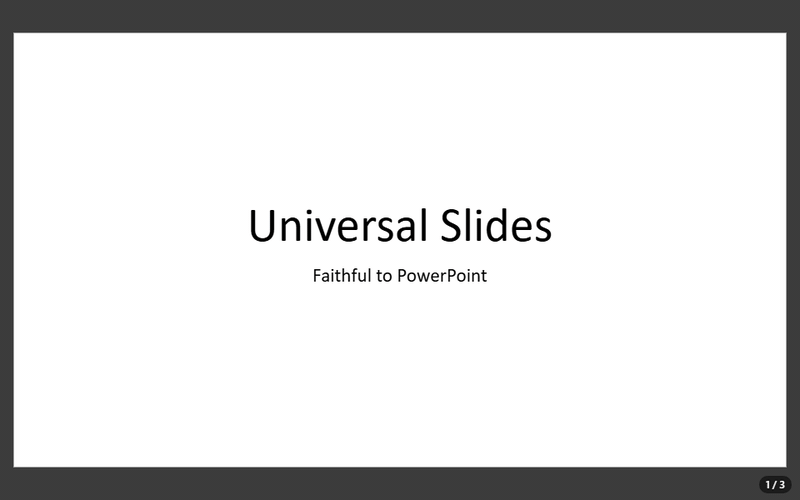

# @universal-office/slides

The `<universal-slides>` web component — a **.pptx editor** built on the same
rendering as [`<universal-presentation-viewer>`](../viewer/README.md): slides
faithful to Microsoft PowerPoint, transitions, animations, the slide show and
automatic playback, plus editing — and, if you want it, a complete
PowerPoint-like interface out of the box.



- Everything the viewer does (it extends `UniversalPresentationViewerElement`):
  same methods and events, slide show, playback, thumbnails, notes
- Editing that goes to the file: text in place (double-click), slides (new
  from a layout, duplicate, delete, reorder, hide, layout, background,
  transition), shapes (text box, preset shapes, pictures; move, resize, fill,
  outline, order, delete, copy/paste, link), text formatting, speaker notes,
  document properties, "Set Up Slide Show", undo/redo
- Optional built-in interface (`topbar`, `bottombar`): a compact bar like
  Google Slides (title above the menus) or a ribbon like PowerPoint
  (`toolbar="ribbon"`), the slide thumbnails pane, the notes pane, Slide
  Sorter and Reading views, the status bar, PowerPoint's keyboard shortcuts,
  English/Portuguese (`lang`) and light/dark (`color-scheme`, `theme`)
- Fonts in the file: embed the used fonts when saving, like PowerPoint's
  "Embed fonts in the file"
- Opens .pptx and .ppt; saves .pptx; exports PDF, HTML, Markdown and PNG

Just want to edit presentations? The same editor is a ready-to-run desktop
app, **Universal Slides (Beta)**, for Windows, macOS and Linux:
[download it from the releases page](https://github.com/tools-universal/universal-office-desktop/releases/tag/slides-v0.0.1).

## Installation

```bash
npm install @universal-office/slides
```

All the code is inside the package; its only dependency is
`@universal-office/font-files` (pinned to an exact version), the open fonts. Serve `chunks/`
next to `index.js` (the interface, the exporters and other rarely used parts
load on demand from there) and the font-files package folder, and point the
`fonts` attribute at it, as for the viewer.

```js
import '@universal-office/slides';
```

A complete editor in one tag — bars, thumbnails, notes and status bar:

```html
<universal-slides id="deck" topbar bottombar storage-key="my-app"
  fonts="/node_modules/@universal-office/font-files" style="display:block; height:100vh"></universal-slides>
```

```js
const deck = document.getElementById('deck');
deck.openPresentation(new Uint8Array(await (await fetch('/pitch.pptx')).arrayBuffer()), { name: 'pitch.pptx' });
```

Or only the slide area, inside your own UI (no attribute = no bar, exactly as
before):

```js
deck.loadPptx(bytes);
deck.addSlide();                 // after the current one, from its layout
deck.selectShape(0);
deck.formatText({ bold: true, size: 32 });
const pptx = await deck.savePptx();
```

## Built-in interface

| Attribute | Description |
|---|---|
| `topbar` | The top bar (menus and tools), the **thumbnails** pane on the left and the **notes** pane under the slide. Also turns on the editing surface: click to select a shape, drag to move, handles to resize (Shift keeps the proportions), double-click/F2/Enter to edit the text, the keyboard shortcuts, drag and drop and the clipboard. |
| `bottombar` | Status bar: "Slide n of N" (click to go to a slide), notes, the views (Normal, Slide Sorter, Reading, Slide Show) and zoom. |
| `toolbar="compact\|ribbon"` | Compact bar (default: like Google Slides — the title above the menus, a tool row that collapses by priority) or ribbon (like PowerPoint — tabs and groups, with the contextual **Shape Format** tab while a shape is selected). The View menu switches too, saved per instance. |
| `lang` | Interface language (`en`, `pt`; default: the browser's). |
| `theme="auto\|light\|dark"` | Forces light/dark; without it the bars follow the CSS `color-scheme` of the page (`light dark` = the system's). View › Theme chooses too. |
| `hidden-commands` | Ids hidden in the bars, menus and shortcuts — commands (`new`, `open`, `print`, `textbox`…), menus (`file`, `slideshow`…), groups (`slides`, `shape`…) and tabs (`transitions`…). Comma or space separated; also the `hiddenCommands` property. |
| `storage-key` | Saves the interface choices (compact/ribbon, theme, panes) in `localStorage` under this key (or the `id`); without it they last for the page. |

What the bars offer (menus of the compact bar; the ribbon has the same in
PowerPoint's tabs — File, Home, Insert, Design, Transitions, Animations,
Slide Show, View, Shape Format):

- **File** — New, Open, Save, Save as, Download (PDF, web page, Markdown,
  current slide as PNG), Fonts in file, Print (one slide per page, painted by
  the same engine as the screen), Properties.
- **Edit** — Undo, Redo, Cut, Copy, Paste (shapes, also between editors and as
  text to other apps; pasted images and text become a picture/text box),
  Delete, Find, Replace.
- **View** — Normal, Slide Sorter, Reading View, Thumbnails, Notes, Status
  bar, Zoom (fit, 25–300 %, Ctrl+wheel), Theme, Toolbar (compact/ribbon).
- **Insert** — New slide (with a layout), Duplicate slide, Text box, Image,
  Shapes (28 Office presets), Link.
- **Format** — Bold, Italic, Underline, Strikethrough, Font, Size,
  Increase/Decrease font size, Font color, Align (left, center, right,
  justify), Bullets, Numbering, Clear formatting, Shape fill, Shape outline,
  Arrange (bring to front, forward, backward, send to back), Size and position.
- **Slide** — New, Duplicate, Delete, Hide, Move up/down, Layout, Background
  (color, reset, apply to all), Transition.
- **Slide Show** — From beginning (F5), From current slide (Shift+F5), Play
  automatically (uses the timings), Set up slide show (kiosk, loop, with or
  without animations, use timings — saved in the file), Hide slide, Preview
  animations, Animation pane.
- **Transitions** (ribbon tab / Slide › Transition) — 21 effects (Fade, Push,
  Wipe, Split, Cover, Uncover, Random Bars, Circle, Diamond, Plus, Wedge,
  Wheel, Zoom, Dissolve, Newsflash, Blinds, Checkerboard, Strips, Comb, Cut,
  None), effect options (direction), speed, advance on click / after N
  seconds, Apply to all, Preview.
- **Animations** — Preview and a read-only Animation pane: the animations of
  the file play exactly as in the slide show, but adding or editing animations
  is not available yet.
- **Help** — Keyboard shortcuts, About.

The thumbnails pane selects with a click, reorders by dragging, and has the
slide context menu (new, duplicate, delete, hide, layout, background,
transition, move); in it Delete removes the slide and Enter adds one.

Keyboard shortcuts (PowerPoint's): F5 / Shift+F5 present, Ctrl+M new slide,
Ctrl+D duplicate (the selected shape, or the slide), Ctrl+Z / Ctrl+Y,
Ctrl+X / C / V, Delete, F2 / Enter edit the text, Escape deselect, Tab next
shape, arrows nudge (Ctrl: 1 pt) or change slides, Ctrl+B / I / U,
Ctrl+] / Ctrl+[, Ctrl+L / E / R / J, Ctrl+Space clear formatting, Ctrl+K link,
Ctrl+F / Ctrl+H, Ctrl+O / S / Shift+S / P, Ctrl+= / Ctrl+-. While editing
text in place (with the bars), Enter starts a new paragraph and Escape leaves
the box keeping the text.

### Customizing the bars

**Hide** what your app does not need with `hidden-commands`. **Extend** them
with plugins — the same model as `<universal-write>`: `toolbar` returns
commands and where they go in the compact bar and in the ribbon.

```js
import { UniversalSlidesElement } from '@universal-office/slides';

const share = {
  id: 'acme.share',
  toolbar: ({ editor, ui }) => ({
    commands: [{ id: 'acme:share', label: { en: 'Share', pt: 'Compartilhar' }, icon: 'send', run: () => shareDeck(editor) }],
    compact: {
      menus: [{ id: 'acme', label: 'Acme', items: ['acme:share'], before: 'help' }],
      trailing: [{ id: 'acme:share-btn', widget: () => ({ el: ui.createBarButton({ icon: 'send', label: { en: 'Share', pt: 'Compartilhar' }, variant: 'tonal', onClick: () => shareDeck(editor) }) }) }],
    },
    ribbon: { groups: [{ tab: 'home', id: 'acme', label: 'Acme', cells: [{ cmd: 'acme:share', size: 'large' }] }] },
  }),
};
UniversalSlidesElement.register(share); // every instance; or deck.use(share)
```

A contribution can also replace the title (`compact.title` / `ribbon.title`)
and the logo (`compact.leading`). `setNotice(el, { tone })` shows a notice
band between the title/menus and the tools. `loadBarKit(lang)` gives the
bar's buttons, icons and CSS to build matching UI outside the editor.

The look follows the Material 3 tokens of `@universal-material` when the page
defines them (`--u-color-*`); otherwise the component uses its own palette.
CSS custom properties: `--us-background` (the single background of bars,
panes and desk), `--us-desk` (around the slide), `--us-font`,
`--us-thumbnails-width`, `--us-notes-height`, `--us-sorter-size`, and the
`--uo-*` of the bars. Parts: `topbar`, `bottombar`, `thumbnails`, `sorter`,
`notes`, `statusbar`, and the bars' `toolbar`, `titlebar`, `menubar`,
`toolrow`, `tabs`, `ribbon`, `menu`, `dialog`.

### Integration with the host app

`appHost` (optional) is what only the host can do — native file dialogs,
printing, the window. Without it the bars use the web path (File System
Access with download as fallback, the browser's print dialog,
`beforeunload`).

```js
deck.appHost = {
  openFile: () => bridge.open(),                       // { name, bytes, path? } | null
  saveFile: (bytes, { name, saveAs, path }) => bridge.save(bytes, name, path), // name or { name, path } | null
  exportFile: (kind, name, data) => bridge.export(kind, name, data), // kind: pdf | html | md | png
  print: ({ pages, title, landscape }) => bridge.print(pages),       // pages: PNG data URLs, one per slide
  setDirty: (dirty, name) => bridge.setDirty(dirty, name),
  onSaveBeforeClose: (cb) => bridge.onSaveBeforeClose(cb),
  closeWindow: () => bridge.close(),
  setTitleTheme: (dark) => bridge.setTitleTheme(dark),
  setTitle: (title) => { document.title = title; },
  windowControlsOverlay: true, // frameless window: the title row reserves the OS controls and drags the window
};
```

## API

All attributes, methods and events of
[`<universal-presentation-viewer>`](../viewer/README.md#methods) apply, except
the control-bar ones (`nocontrols`, `no<item>`, the `--upv-controls-*`
properties and the bar's parts). Every edit is one undo step and goes to the
package — only the edited part of each XML part changes; the rest of the file
stays byte for byte. Shape indexes are positions in the current slide's
shapes; `i` defaults to the selected shape (or the one being edited).

| Member | Description |
|---|---|
| `openPresentation(bytes, { name?, path? })` | Opens like File › Open: loads, sets the name (title) and the host path. |
| `newPresentation({ aspect? })` | A blank presentation (16:9 or 4:3) with the Office theme, six layouts and a notes master. |
| `documentName` | Name shown in the title and suggested when saving. |
| `savePptx(): Promise<Uint8Array>` | Saves the presentation with the font-embedding setting applied. |
| `isDirty()` · `markClean()` · `undo()` · `redo()` · `canUndo()` · `canRedo()` | Unsaved changes and undo/redo. |
| `getFontEmbedding()` · `setFontEmbedding({ embed, subset, skipCommonFonts })` | Fonts in the file. Default: off; when on, only the used characters, and never the common fonts PowerPoint skips (Arial, Times New Roman, Courier New, Calibri, Aptos). |
| `getLayouts()` · `getSlideLayout(i)` · `setSlideLayout(path, i)` | Layouts of the masters (`{ path, name, type, master }`). |
| `addSlide(layout?)` · `duplicateSlide(i)` · `deleteSlide(i)` · `moveSlide(from, to)` | Slides. A new slide gets the layout's placeholders, empty (with the "Click to add…" prompts on screen only). |
| `isSlideHidden(i)` · `setSlideHidden(hidden, i)` · `getSlideBackgroundColor(i)` · `setSlideBackground(color \| null, i \| 'all')` | Hide slide, solid background. |
| `getSlideTransition(i)` · `setSlideTransition(spec \| null, i \| 'all')` | `{ type, dir?, speed?, advanceOnClick?, advanceAfterMs? }` (`TRANSITION_TYPES`). |
| `getShowSettings()` · `setShowSettings({ loop, useTimings, showAnimation, kiosk })` | "Set Up Slide Show", saved in the file. |
| `previewSlide('transition' \| 'animations')` | Plays the current slide's transition or animations in place. |
| `getSlideAnimations(i)` | The slide's animations (read-only): step, trigger, effect, target shape, duration. |
| `getSelectedShape()` · `selectShape(i \| null)` · `getShapeInfo(i)` | Selection and what a shape is (`kind`, `frame`, `text`, `movable`). |
| `beginEditShape(i)` · `commitEditShape()` · `cancelEditShape()` · `getEditingShape()` | Text editing in place. Unchanged paragraphs keep their runs; an edited paragraph keeps its paragraph properties and the formatting of its first run. |
| `setShapeText(text, i)` | Replaces the shape's text (one paragraph per line). |
| `getTextFormat(i)` · `formatText({ bold, italic, underline, strike, size, font, color }, i)` · `toggleTextFormat(k, i)` · `growFont(±1, i)` | Character formatting of the shape's whole text. |
| `alignText('l' \| 'ctr' \| 'r' \| 'just', i)` · `setBullets('bullet' \| 'number' \| 'none', i)` · `clearFormatting(i)` · `setLink(url \| null, i)` · `getLink(i)` | Paragraphs, bullets, link. |
| `insertTextBox(text?, frame?)` · `insertShape(prst, frame?)` · `insertImage(bytes, mime, frame?)` | New shapes (EMU frames; centered by default); returns the index, selected. |
| `setShapeFrame(frame, i)` · `setShapeFill(color \| null, i)` · `setShapeOutline(color \| null, i)` · `arrangeShape('front' \| 'back' \| 'forward' \| 'backward', i)` · `deleteShape(i)` | Shape geometry and look (deleting also removes its animations). |
| `copyShape(i)` · `pasteShape(clip)` · `duplicateShape(i)` | Shape clipboard (pictures carry their bytes, so a clip pastes into another editor too). |
| `canEditNotes(i)` · `setSlideNotes(text, i)` | Speaker notes (creates the notes page when the deck has a notes master). |
| `getProperties()` · `setProperties({ title, subject, author, keywords, description })` | Document properties. |
| `findText(query, { matchCase })` · `replaceText(query, replacement, { matchCase, hit })` | Find and replace in the shapes' text (within runs of the same formatting). |
| `getZoom()` · `setZoom(z \| 'fit')` · `isZoomFit()` | Zoom (1 = 100 %). |
| `use(plugin)` · `unuse(id)` · `UniversalSlidesElement.register(plugin)` | Plugins. |
| `setNotice(el, { tone })` · `appHost` · `hiddenCommands` · `effectiveTheme` | Bars: notice band, host integration, hidden ids, light/dark. |

| Event | `detail` | When |
|---|---|---|
| `us-change` | `{ kind, index }` | After every edit (and undo/redo). |
| `us-selection` | `{ index, shape }` | The selected shape changed. |
| `us-dirty` | `{ dirty }` | The unsaved-changes state changed. |
| `us-title-change` | `{ name }` | `documentName` changed. |
| `us-zoom` | `{ zoom, fit }` | The zoom changed. |
| `us-theme-change` | `{ theme }` | The effective light/dark changed. |
| `us-file-drop` | `{ files }` | Files dropped on the editor (with `topbar`); cancel it to handle them yourself. |
| `us-shape-edit` | `{ slide, shapeIdx, text }` | A text edit was committed. |
| `us-font-embedding` | `{ embedded, skipped: { family, reason }[] }` | After `savePptx()`; `reason` is `'common'`, `'license'` or `'unavailable'`. |

## Current limitations

- Text is edited per shape, as plain text: character formatting applies to
  the whole text of the shape (no formatting of a selection inside the box);
  an edited paragraph keeps the formatting of its first run.
- Shapes inside groups can have their text edited and formatted, but not be
  moved, resized, copied or reordered; SmartArt and layout/master decorations
  are not selectable. Tables and charts can be moved, not edited.
- Not available yet: adding or editing animations (they play and preview),
  tables, charts, SmartArt, video/audio insertion, rotation, grouping,
  aligning objects, line/character spacing, highlight, slide size, headers and
  footers, comments, rehearse timings, presenter view, custom shows, the Notes
  Page view, rulers and guides, transition durations other than
  fast/medium/slow (the p14 duration) and the newer transitions (Morph…),
  which play but cannot be chosen.
- The PDF export is a simplified vector PDF (office-converter, set in the open
  Liberation Sans; charts as placeholders, no shadows); Print paints the slides
  exactly as on screen (use "Save as PDF" in the print dialog for a faithful
  PDF).

## License

MIT. The fonts (`@universal-office/font-files`) are under the SIL OFL 1.1
and the Apache License 2.0.
