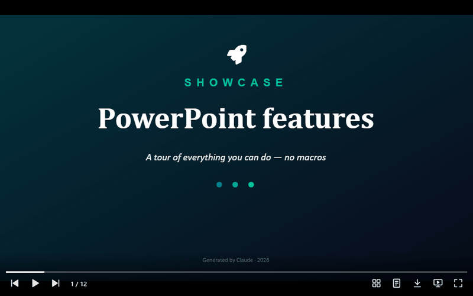

# @universal-office/presentation-viewer

The `<universal-presentation-viewer>` web component: plays **.pptx and .ppt**
presentations faithful to Microsoft PowerPoint — slide transitions, entrance,
emphasis and exit animations, timings, media, charts, SmartArt and tables —
with a player-style control bar, like the browser's `<video>`.



- Slide show (F5-style) with click steps, or automatic playback with the
  file's timings
- Control bar: previous/next, play, mute, thumbnails, speaker notes,
  download, present, full screen and a seekable progress bar
- Fonts embedded in the file are used; missing ones fall back like PowerPoint
- Accessible: a text version of each slide for screen readers, announced on
  every change; full keyboard support; English and Portuguese UI
- Any control can be removed or restyled from outside

## Installation

The package is self-contained: one ES module plus two folders that must be
served next to it.

| Path | What it is |
|---|---|
| `index.js` | The component (registers `<universal-presentation-viewer>` on import) |
| `chunks/` | Parts loaded on demand |
| `fonts/` | Open fonts used as metric-compatible substitutes |

```js
import '@universal-office/presentation-viewer';
```

```html
<universal-presentation-viewer src="/pitch.pptx" fonts="/office/fonts"
  style="display:block; aspect-ratio:16/9"></universal-presentation-viewer>
```

Give the element a size with CSS — the slide is fitted inside, and the rest
is letterbox.

## Attributes

| Attribute | Description |
|---|---|
| `src` | Presentation to fetch (same origin or CORS). The file name is used for the download and the accessible name. |
| `fonts` | Folder with the open fonts (the package's `fonts/`). Read on the first load. |
| `nocontrols` | Removes the whole control bar. |
| `no<item>` | Removes one control: `nonav`, `nocounter`, `noplay`, `nomute`, `nothumbnails`, `nonotes`, `nodownload`, `nopresent`, `nofullscreen`, `noprogress`. Items that do not apply hide themselves (mute without media, notes without notes). |
| `lang` | UI language (`en` · `pt`). Without it: Portuguese if the browser prefers it, otherwise English. |

## Methods

| Method | Description |
|---|---|
| `loadPptx(bytes: Uint8Array)` | Opens .pptx or .ppt. Throws on an invalid file and keeps the current one. |
| `getSlideCount()` · `getSlideIndex()` · `selectSlide(i)` · `next()` · `prev()` | Navigation (0-based). |
| `present(from?, opts?)` · `stopPresentation()` · `isPresenting()` | Slide show. `from = 'start'` begins at the first visible slide. Call from a user gesture (full screen needs one). |
| `play(opts?)` · `stopPlayback()` · `isPlaying()` | Automatic playback with the file's timings. |
| `getSlideNotes(i)` | Speaker notes as plain text. |
| `renderSlideToCanvas(i, canvas, width = 1280)` | Renders a slide at an exact size — e.g. to export a PNG. |
| `renderThumbnail(i, canvas)` | Renders a slide fitted into a canvas. |
| `toggleFullscreen()` · `fontsReady()` | Full screen without presenting; wait for fonts. |

`present()` options (defaults come from the file's slide-show settings):
`{ useTimings, loop, fullscreen, animations, kiosk }`. `play()` options:
`{ from, loop, useTimings, defaultSlideMs, media: 'realtime' | 'seek' }`.

## Events

| Event | `detail` | When |
|---|---|---|
| `us-loaded` | `{ count }` | A presentation finished loading. |
| `us-error` | `{ src, error }` | `src` could not be fetched or read. |
| `us-slide` | `{ index }` (`{ index, step, steps }` while presenting) | The slide changed. |
| `us-step` | `{ index, step, steps }` | A click step while presenting. |
| `us-present-end` | `{ index }` | The slide show ended. |
| `us-playback-end` | — | Automatic playback ended. |
| `us-image` | `{ part }` | An image finished decoding (redraw your own thumbnails). |
| `us-download` | `{ bytes, filename }` | Download button. **Cancelable** — `preventDefault()` to handle the file yourself. |

## Styling

Each property first reads `--upv-<name>`, then the shared `--uo-<name>`
(one theme for both viewers):

| Property | Default |
|---|---|
| `--upv-background` | `#000` (letterbox) |
| `--upv-focus-color` | `#4ea1ff` |
| `--upv-controls-color` · `--upv-controls-size` · `--upv-controls-bg` · `--upv-controls-hover-bg` | `#fff` · `22px` · dark gradient · translucent white |
| `--upv-progress-color` · `--upv-progress-track` · `--upv-progress-height` | `#fff` · translucent white · `3px` |
| `--upv-notes-height` · `--upv-thumbnails-bg` | `28%` · translucent black |

Parts for `::part()`: `controls`, `progress`, `progress-value`, `counter`,
`thumbnails`, `thumbnail`, `notes`, `slide-text`, `button` and
`button-<name>` (`prev`, `play`, `next`, `mute`, `thumbnails`, `notes`,
`download`, `present`, `fullscreen`). The bar hides itself after 2.5 s
without movement.

```css
universal-presentation-viewer {
  --uo-progress-color: #e91e63;
  --upv-controls-size: 26px;
}
universal-presentation-viewer::part(button-present) { display: none; }
```

## Keyboard

| Keys | Navigating | Presenting |
|---|---|---|
| → · PageDown · Space (also ↓ Enter N when presenting) | Next slide | Next step |
| ← · PageUp (also ↑ Backspace P when presenting) | Previous slide | Previous step |
| Home · End | First / last slide | First / last slide |
| F | Full screen | — |
| Esc | Stop playback | End the slide show |

## Formats

Input: `.pptx` (and `.pptm`, `.ppsx`, `.potx`…) and `.ppt` (PowerPoint
97–2003, converted in memory). Output: the original file (download), PNG via
`renderSlideToCanvas`.
