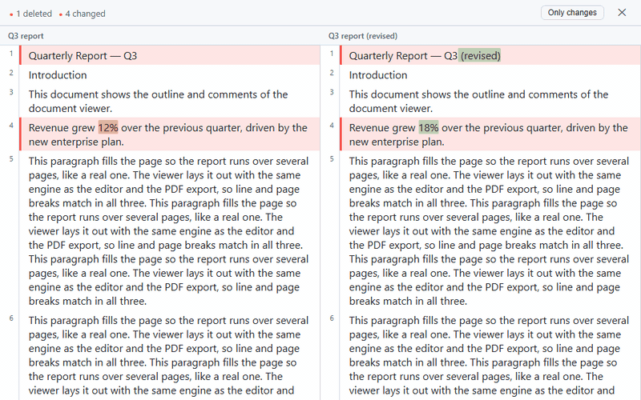

# @universal-office/compare

Compare two .docx documents: a **diff engine** for Word documents and the
`<universal-write-diff>` web component that shows the result side by side.



- Paragraphs aligned side by side in one scroll, with insertions, deletions
  and changes highlighted — down to the word inside a changed paragraph
- Table rows compared one by one; images compared by their bytes
- Same text with different formatting is reported as a formatting change
- Unchanged runs collapse into clickable "N unchanged blocks" bands
- Selectable, copyable text (rendered in the DOM, not a canvas)
- English, Portuguese and Spanish UI; light and dark (follows `color-scheme`)

## Installation

```bash
npm install @universal-office/compare
```

The package is self-contained: one ES module plus `chunks/` (loaded on
demand), served next to it. No fonts are needed — the comparison is drawn
with the page's CSS fonts.

```js
import '@universal-office/compare';
```

```html
<universal-write-diff id="diff" left-label="v1" right-label="v2"
  style="display:flex; height:80vh"></universal-write-diff>
```

```js
const diff = document.getElementById('diff');
const [a, b] = await Promise.all(['/v1.docx', '/v2.docx'].map(async (u) =>
  new Uint8Array(await (await fetch(u)).arrayBuffer())));

diff.loadPair(a, b);
diff.addEventListener('ready', (e) => console.log(e.detail.stats));
// { inserted, deleted, changed, formatOnly, equal }
```

## Attributes and properties

| Attribute | Values | Description |
|---|---|---|
| `view` | `all` (default) · `diffs` | `all` shows every block; `diffs` collapses unchanged runs into bands. The **Only changes** button toggles it. |
| `left-label` · `right-label` | text | Column titles (default "Original" / "Modified"). |
| `lang` | `en` · `pt` · `es` | UI language (any region: `es-MX`, `es-419`… → Spanish). Without it: the first of Spanish/Portuguese/English the browser prefers (`es-*` → Spanish, `pt-*` → Portuguese), otherwise English. |

Properties: `view` (get/set) and `stats` (the last result's counts, or `null`).

## Methods

| Method | Description |
|---|---|
| `loadPair(aBytes, bBytes, { leftLabel?, rightLabel? })` | Compares two .docx files. |
| `loadDocuments(aDoc, bDoc, opts)` | Compares documents already read with `readFullDocument` (exported). |

## Events

All bubble and cross shadow roots.

| Event | `detail` | When |
|---|---|---|
| `ready` | `{ stats }` | The comparison is shown. |
| `block-click` | `{ editIndex, side: 'a' \| 'b', blockIndex }` | A block was clicked (e.g. to jump to it in an editor). |
| `close-request` | — | The ✕ button. The element does not close itself. |

## Styling

Set these on the element (they use `light-dark()`):
`--uwd-insert-bg`, `--uwd-insert-bg-intra`, `--uwd-delete-bg`,
`--uwd-delete-bg-intra`, `--uwd-minor-bg`, `--uwd-stripe-insert`,
`--uwd-stripe-delete`, `--uwd-stripe-minor`, `--uwd-border`, `--uwd-text`,
`--uwd-text-2`, `--uwd-chrome`, `--uwd-page`.

## Diff engine (no UI)

The engine runs without the DOM (browser or Node):

```js
import { DocxPackage, readFullDocument, diffDocuments } from '@universal-office/compare';

const read = (bytes) => readFullDocument(DocxPackage.load(bytes));
const result = diffDocuments(read(a), read(b));
// result.edits: equal / insert / delete / change blocks, with word-level marks
// result.stats: { inserted, deleted, changed, formatOnly, equal }
```

Options: `{ algorithm: 'histogram' | 'myers', intraWord: boolean }`
(defaults: histogram, word-level marks on). The lower-level pieces
(`diffBlocks`, `tokenizeBlocks`, `myersDiff`, `histogramDiff`…) are exported
too.

## License

MIT
