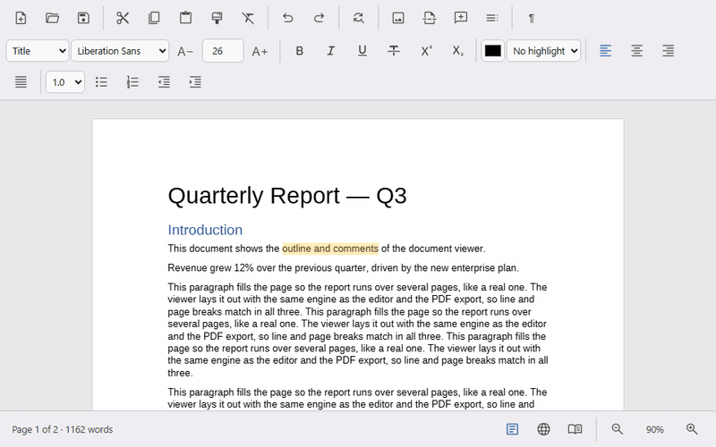

# @universal-office-pro/write

The `<universal-write>` web component — a **.docx editor** that paints the
document to a **canvas** with layout faithful to Microsoft Word (real font
metrics, the same line and page breaks) and a lossless OOXML round-trip: parts
it does not model are saved back byte for byte.



- Full editing: its own caret, selection, IME and clipboard; undo/redo
- Paragraph and character formatting, styles, lists, tables, images,
  headers and footers, fields, table of contents, comments
- Print, Web, Read, Draft and Outline views; zoom; formatting marks
- Opens .docx, .doc and .odt; saves .docx, .odt, PDF, XPS, HTML and Markdown
- Optional built-in bars: a compact toolbar (default)
  or a ribbon with tabs, plus a status bar; English and Portuguese UI
- Plugins for custom inline content (e.g. @mentions)

## Installation

Obtain the package from **PrivJS** and follow the setup instructions there.

The package is self-contained — no dependencies. Serve these folders next to
`index.js`:

| Path | What it is |
|---|---|
| `index.js` | The component (registers `<universal-write>` on import) |
| `chunks/` | Parts loaded on demand (toolbar, hyphenation patterns, rare converters) |
| `fonts/` | Open fonts — **Liberation Sans is required** (see [Fonts](#fonts)) |

```js
import '@universal-office-pro/write';
```

```html
<universal-write id="editor" fonts="/office/fonts" topbar bottombar
  style="display:block; height:100vh"></universal-write>
```

```js
const editor = document.getElementById('editor');

editor.addEventListener('uw-ready', async () => {
  const bytes = new Uint8Array(await (await fetch('/contract.docx')).arrayBuffer());
  editor.load(bytes, 'auto', { protected: false });
  editor.focusEditor();
});

const docx = await editor.save('docx');   // Uint8Array
const pdf  = await editor.save('pdf');    // Uint8Array
const md   = await editor.save('markdown'); // string
```

Give the element a size with CSS — it fills its box and scrolls inside.

## Attributes

| Attribute | Values | Description |
|---|---|---|
| `fonts` | URL | Folder with the font files (the package's `fonts/`). Read at initialization. |
| `src` | URL | Document opened at initialization (in Protected View, like Word). |
| `topbar` | boolean | Built-in top bar with menus, find/replace, comments beside the page, open/save, autosave, Protected View and drag and drop (see [Built-in bars](#built-in-bars)). |
| `toolbar` | `compact` · `ribbon` | Style of the top bar: `compact` (default — menu bar + one toolbar row that collapses by priority, like Google Docs) or `ribbon` (tabs and groups, like Word). |
| `bottombar` | boolean | Built-in status bar: page/word count, view buttons, zoom. |
| `theme` | `auto` · `light` · `dark` · `black` | Opt-in Material theme for the bars, scoped to the element (`black` also darkens the page). Without it — and without a choice in View › Theme — the element inherits `color-scheme` and the `--u-color-*` tokens from the page. |
| `accent` | `blue` · `teal` · `green` · `amber` · `red` · `purple` · `neutral` | Accent color of the opt-in theme. |
| `storage-key` | string | Remembers this instance's bar choices (toolbar style, theme, comments, autosave interval) in `localStorage`. Falls back to `id`; with neither, choices last only for the session. |
| `noautosave` | boolean | No autosave and no "autosave pending" notice. |
| `nounloadprompt` | boolean | No browser "leave page?" prompt for unsaved changes. |
| `nospellcheck` | boolean | No spell checking (no red squiggles, no suggestions). |
| `lang` | `en` · `pt` | UI language of the bars and popups. Without it: Portuguese if the browser prefers it, otherwise English. |
| `author` | string | Name recorded on tracked changes and new comments. Without it the bars use the host's user name (Electron: the OS user) or ask once and remember the answer; the bare API falls back to "Author"/"Autor". |
| `manual-init` | boolean | Do not initialize on connect; call `initialize()` yourself (offline use). |
| `layout` | `legacy` | Use the previous canvas layout instead of the Word-fidelity engine. The editor also falls back to it on its own if the engine fails on a document. |

## Built-in bars

`topbar` turns the element into a complete editor — nothing to wire:

- **Compact** (`toolbar="compact"`, default): File · Edit · View · Insert ·
  Format · Tools · Help menus and one toolbar row; when space runs out, the
  lowest-priority groups collapse into their own buttons and then into "⋮",
  and the menus into "☰".
- **Ribbon** (`toolbar="ribbon"`): quick access toolbar, File menu, Home ·
  Insert · Design · Layout · References · Mailings · Review · View tabs,
  groups with dialog launchers (Font, Paragraph, Page Setup) and contextual
  tabs (Header & Footer while editing them; Table Design and Table Layout
  inside a table; Picture as soon as the editor exposes its commands). The Styles group is a **gallery** of
  thumbnails drawn with each style's real formatting (scroll by row, expand,
  right-click to update, modify, rename or remove from the gallery); its
  launcher opens the **Styles pane**.
- Both: find and replace, comments and revision balloons as cards beside the
  page, Track Changes (Review tab; Tools › Track Changes), the Reviewing Pane, link/comment
  dialogs, font and paragraph dialogs, word count, theme (automatic, light,
  dark, dark page) and accent color, focus mode (full screen) and read mode,
  context menu, drag and drop of .docx/.odt, autosave (with a file opened
  through the File System Access API), recent files, Protected View with
  trusted documents and the "update fields" prompt, "Compare with…" and
  "Fonts in the file…". Styles: the Styles pane (filter, sort, preview, apply,
  per-style menu), the Create/Modify Style dialog and the Style Inspector
  (Format › Styles in the compact bar).
- A command whose API the editor does not have yet stays hidden, so new
  editor features only need the method to show up in the bars.

Theme the bars with CSS variables on the element: `--uw-font` (UI font),
`--uw-desk` (background behind the pages), `--uo-bar-bg`,
`--uo-bar-container`, `--uo-accent`, `--uo-menu-bg`, `--uo-hover-bg`. Parts:
`toolbar`, `titlebar`, `menubar`, `toolrow`, `tabs`, `ribbon`, `menu`,
`popover`, `dialog`, `find`, `comments`, `review-pane`, `statusbar`, `protected-bar`,
`compare`.

What only the host application can do comes in through the optional
`editor.host` object (an Electron shell, for example); without it the bars use
the browser (File System Access, downloads, `beforeunload`):

```js
editor.host = {
  openFile: () => bridge.open(),            // → { name, bytes, motw? } | null
  openFileForCompare: (title) => bridge.open(title),
  saveFile: (bytes, { name, format, saveAs }) => bridge.save(bytes, name), // → saved name | null
  listFonts: bridge.listFonts, resolveFonts: bridge.resolveFonts,           // OS fonts
  setDirty: (dirty, name) => bridge.setDirty(dirty, name),                  // confirm on close
  onSaveBeforeClose: (cb) => bridge.onSaveBeforeClose(cb),
  closeWindow: () => bridge.close(),
  setTitleTheme: (dark) => bridge.setTitleTheme(dark),
  setTitle: (title) => { document.title = title; },
  userName: () => bridge.userName(),        // author of tracked changes and comments
  windowControlsOverlay: true, // frameless window: reserve the OS window buttons
};
```

`openDocument(editor, bytes, name, { motw })` (exported) opens a document the
way File › Open does: title, recent files and Word's Protected View rule.

When the page saves and opens documents itself, handle the cancelable
`uw-save-request` (`detail: { saveAs, format }`) and `uw-open-request` events
and call `preventDefault()`: the bars then do nothing for those actions (menu,
button, Ctrl+S / Ctrl+O), and after the first handled save request they also
drop autosave and the leave-page prompt — saving belongs to the host.

App shortcuts (Ctrl+O, S, Shift+S, P, F, H) also work while focus is on the
page body, for the last focused `<universal-write topbar>` (or the only one),
never while typing in another element's field. Removing the element from the
document tears the bars down completely (timers and window/document
listeners); putting it back rebuilds them.

## Spelling

Words are checked as you type with Hunspell (open LibreOffice dictionaries:
pt-BR and en-US, loaded on demand) in a Web Worker, by the language of each
run (`w:lang`, then character style, paragraph style and document defaults;
`w:noProof` is skipped). Misspellings get a red squiggle on screen only (never
in PDF, print or the viewer); right-click one for suggestions, **Ignore All**
and **Add to Dictionary** (kept in `localStorage`). **Tools › Spelling & grammar**
(F7) walks through the errors. Languages without a dictionary are not checked.

## Track changes

With **Track Changes** on (Review › Track Changes, Ctrl+Shift+E), typing,
deleting, Enter and formatting become revisions with author and date, exactly
as Word writes them (`w:ins`, `w:del`, `w:rPrChange`, `w:pPrChange`, paragraph
marks; checked against Word 365 operation by operation). Your own insertions
disappear when deleted; other authors' text stays, struck through. The state is
saved in the .docx (`w:trackRevisions`), so a document opens the way it was
saved, and revisions written by Word open as revisions.

**Display for Review** has Word's four modes: **Simple Markup** (final text and
red change bars), **All Markup** (default: insertions underlined and deletions
struck in each author's color, black change bars, formatting changes in
balloons beside the page), **No Markup** and **Original**. **Show Markup** picks
the types (insertions and deletions, formatting, comments), the balloons
(revisions in balloons, all inline, only comments and formatting) and specific
people. PDF export and printing follow the mode on screen, without the balloon
area. The **Reviewing Pane** (vertical or horizontal) lists every revision with
counts by type; click to go there, ✓/✗ to accept or reject. Accept and Reject
work on the selection or the revision at the cursor and move to the next one,
like Word; their menus also have *This Change*, *All Changes Shown*, *All
Changes* and *All Changes and Stop Tracking*.

Not yet: list numbering changes in All Markup (Word shows the old number struck
next to the new one), table/cell/section property revisions (kept as they are),
and moves created by editing (cut and paste becomes a deletion plus an insertion).

## Loading and saving

| Method | Description |
|---|---|
| `load(bytes, format = 'auto', { protected })` | Opens .docx, .doc (converted) or .odt; `'auto'` detects the format. .docx opens protected (read-only) unless `protected: false`. |
| `newDocument()` | Empty A4 document with Word's blank-document styles, theme and settings (Normal, headings, quotes… and the built-in styles applied on first use). |
| `save(format = 'auto', { images, title })` | `'docx'` · `'odt'` · `'pdf'` · `'xps'` → `Uint8Array`; `'html'` · `'markdown'` → `string`. `'auto'` = the format that was loaded. |
| `print()` | Browser print dialog with the pages (call from a user gesture). |
| `isProtected()` · `enableEditing()` | Protected View. `uw-protected` reports changes. |

## Editing API

| Area | Methods |
|---|---|
| Characters | `toggleRunProp('bold' \| 'italic' \| 'underline' \| 'strike' \| 'allCaps' \| 'smallCaps')`, `toggleVertAlign('superscript' \| 'subscript')`, `setFontFamily(name)`, `setFontSize(pt)`, `growFont(±1)`, `setColor(hex)`, `setHighlight(name)`, `setLink(url)`, `setCharSpacing(twips)`, `changeCase('upper' \| 'lower')`, `clearFormatting()` |
| Paragraphs | `applyStyle(styleId)`, `paragraphStyles()`, `setAlignment('left' \| 'center' \| 'right' \| 'both')`, `toggleList('bullet' \| 'decimal')`, `indent(±1)`, `setLineSpacing(line)`, `setSpaceBefore(twips)`, `setSpaceAfter(twips)`, `setSpecialIndent(...)`, `setIndentRight(twips)`, `setShading(hex)`, `toggleBorder()` |
| Format painter | `copyFormat()`, `painterActive()` |
| Insert | `insertImage(bytes, ext)`, `insertPageBreak()`, `insertField('PAGE' \| 'NUMPAGES' \| 'DATE')`, `updateToc()` |
| Page | `setPageSetup({ orientation, size: 'A4' \| 'Letter', margins: 'normal' \| 'narrow' \| 'wide', customMargins, applyTo })` — for the section(s) the selection touches; `applyTo`: `'section'` (default) · `'document'` · `'forward'` (next-page section break at the caret) · `'selection'` (breaks before and after the selection). Changing the orientation rotates the margins. |
| Sections and columns | `insertSectionBreak('nextPage' \| 'continuous' \| 'evenPage' \| 'oddPage' \| 'nextColumn')` (splits the paragraph; the new section before the caret copies the current one and takes its headers/footers), `insertColumnBreak()`, `setColumns('one' \| 'two' \| 'three' \| 'left' \| 'right')` (with selected text, only for it) or `setColumns({ count, spaceTwips, widths, sep, applyTo, startNewColumn })`, `getSection()` → `{ index, count, type, orientation, margins, columns }` |
| Edit | `undo()`, `redo()`, `cut()`, `copy()`, `paste()`, `pastePlain()`, `pasteText(text)`, `selectAll()`, `selectedText()` |
| Find | `findNext(text)`, `replaceAll(text, replacement)` (case-insensitive) |
| Spelling | `spellCheckEnabled()`, `toggleSpellCheck(on?)`, `spellingAtCaret()`, `spellingSuggestions(m)`, `replaceSpelling(m, text)`, `ignoreSpelling(word)`, `addToDictionary(word)`, `nextMisspelling()` |
| Comments | `getComments()`, `addComment(text, author = this.author)`, `removeComment(id)`, `goToComment(id)` |
| Track changes | `toggleTrackChanges(on?)`, `isTrackingChanges()`, `author` (property), `hasAuthor()`, `acceptChange({ moveNext })`, `rejectChange({ moveNext })`, `acceptAllChanges({ shown, stopTracking })` / `rejectAllChanges(…)` → count, `nextChange()`, `previousChange()`, `getRevisions()` → `{ kind, author, date, dateUtc, text, description, mark, move, story, color }[]`, `acceptRevisionAt(i)`, `rejectRevisionAt(i)`, `selectRevision(i)`, `revisionAtCaret()`, `revisionAuthors()`, `authorColor(name)` |
| Markup | `setMarkupMode('simple' \| 'all' \| 'none' \| 'original')`, `getMarkupMode()`, `setMarkupOptions({ insertionsDeletions, formatting, comments, balloons: 'revisions' \| 'inline' \| 'mixed', authors })`, `getMarkupOptions()` |
| Headers/footers | `enterHeaderFooter('header' \| 'footer')`, `exitHeaderFooter()` |
| View | `setView('print' \| 'web' \| 'read' \| 'draft' \| 'outline')`, `getView()`, `setZoom(z)`, `getZoom()`, `toggleMarks()`, `setDarkPage(dark)`, `navigateTo('#bookmark')` |
| State | `stats()` → `{ pages, words, chars, page, paragraph }`, `getSelectionState()`, `currentPage()`, `focusEditor()` |

## Tables

Tables follow Word's rules (measured against Word): what each operation does
to widths, merges, borders and styles, and what it writes to the file. Every
operation is one undo step, works in nested tables and floating tables, and
is refused in Protected View. A table that was read from the file keeps its
original XML for everything the operation did not touch (rows, cells, content
controls and bookmarks inside it).

| Area | Methods |
|---|---|
| Insert and convert | `insertTable(rows, cols, { autofit: 'fixed' \| 'content' \| 'window', colWidthTwips })`, `convertTextToTable({ separator, cols, autofit })`, `textToTableGuess(separator?, cols?)`, `convertTableToText(separator)` — separators: `'paragraph'` · `'tab'` · `'semicolon'` · `'comma'` · `{ char }`; `quickTables()` · `insertQuickTable(id)` (calendar, tabular list, matrix, with subheads, double table — content in the UI language) |
| Rows, columns, cells | `insertRowAbove()` · `insertRowBelow()` · `insertColumnLeft()` · `insertColumnRight()`, `insertCells('right' \| 'down' \| 'row' \| 'column')`, `deleteCells('left' \| 'up' \| 'row' \| 'column')`, `deleteRow()` · `deleteColumn()` · `deleteTable()`, `mergeCells()`, `splitCell(cols, rows, mergeFirst)`, `splitTable()` |
| Select | `selectCell()` · `selectRow()` · `selectColumn()` · `selectTable()`, `editingTableCell()`, `getTableState()` → `TableState` (`rows`, `cols`, `rect`, `cells`, `nested`, `canMerge`, `style`, `look`, `vAlign`, `textDirection`, `headerRow`, `rowHeight`, `colWidth`, `shading`, `tblPr` · `trPr` · `tcPr`, `availTwips`) |
| Size | `setRowHeight(twips, 'atLeast' \| 'exact')`, `setColumnWidth(twips)`, `distributeRows()` · `distributeColumns()`, `autoFitTable('content' \| 'window' \| 'fixed')`, `setTableCellMargins({ top, left, bottom, right }, spacingTwips?, autoResize?)` |
| Properties | `setTableProperties({ table, row, column, cell })` — the Table Properties dialog in one step: `table` (`width` (dxa or pct), `align`, `indentTwips`, `wrap: 'none' \| 'around'`, `position` (floating table), `overlap`, `title`, `description` — Alt Text), `row` (`height`, `allowBreak`, `header`), `column` (`width`), `cell` (`width`, `vAlign`, `margins`, `wrap`, `fitText`). `setCellAlignment(h, v)`, `setTextDirection('lrTb' \| 'tbRl' \| 'btLr')`, `toggleRepeatHeaderRows()` |
| Styles | `tableStyleList()` · `tableStyleListNow()` → `TableStyleInfo[]` (`name`, `label { en, pt }`, `group`: custom · plain · grid · list), `setTableStyle(name \| null)` (built-ins are added to the file on first use, with Word's definition), `setTableStyleOptions({ headerRow, totalRow, bandedRows, firstColumn, lastColumn, bandedColumns })`, `renderTableStyleThumb(canvas, name, look?)` |
| New / modify table style | `tableStyleXml(nameOrId)` → `{ id, xml, inDoc }`, `tableStyleBases()`, `newTableStyleId(name)`, `saveTableStyle(xml, { apply, basedOnName })`, `renderTableStyleXmlThumb(canvas, xml, look?)` — the New/Modify Table Style dialog edits the style per condition (whole table, header row, total row, first/last column, banded rows/columns, corner cells): font, borders, fill and alignment |
| Borders and shading | `setCellBorders(kind, spec?)` (`'all'` · `'outside'` · `'inside'` · `'insideH'` · `'insideV'` · `'top'` · `'bottom'` · `'left'` · `'right'` · `'tl2br'` · `'tr2bl'` · `'none'`), `setTableBorderSides(sides, 'cell' \| 'table')`, `getBorderPen()` · `setBorderPen({ val, sz, color })`, `setCellShading(color \| { themeColor, tint, shade } \| null, pattern?, 'cell' \| 'table')` (patterns `pct10`…, `horzStripe`…, painted with Word's coverage), `setParagraphBorders(sides)` · `getParagraphBorders()`, `getPageBorders()` · `setPageBorders({ offsetFrom, display, zOrder, top, left, bottom, right }, 'section' \| 'document')` |
| Draw | `setTableTool('draw' \| 'eraser' \| 'painter' \| null)` · `getTableTool()`: draw a table or a cell divider, erase a divider (merges the cells), paint borders with the current pen. With the mouse, drag a column or row border to resize, the move handle to float the table, the corner handle to resize it. `showTableGridlines(on)` · `tableGridlinesShown()` — dashed gridlines on screen for tables without borders (never in PDF or print) |
| Sort | `sortInfo(separator?)` → `{ kind: 'table' \| 'paragraphs', columns: [{ text, guess }], header, mergeError }`, `sort({ keys: [{ column, type: 'text' \| 'number' \| 'date', desc }], header, caseSensitive, separator })` — up to three keys (the dialog); text compares like Word (pt-BR word sort); tables with merged cells are refused (`uw-sort-error`) |
| Formula | `suggestFormula()` (`=SUM(ABOVE)` / `=SUM(LEFT)` like Word), `previewFormula(formula, numberFormat?)`, `insertFormula(formula?, numberFormat?)` — a `{ =… }` field with `SUM`, `AVERAGE`, `COUNT`, `MAX`, `MIN`, `PRODUCT`, `ABS`, `INT`, `MOD`, `ROUND`, `SIGN`, `IF`, `AND`, `OR`, `NOT`, `TRUE`, `FALSE`, `DEFINED`, cell references (`A1`, `B2:C4`), `ABOVE` · `BELOW` · `LEFT` · `RIGHT`, and a number format (`\# "#.##0,00"`); `updateFields()` (F9) recalculates them |
| Clipboard | `copy()` · `cut()` of cells and tables (tab-separated text + HTML), `paste()` (cells over the selection, HTML tables become tables), `pasteCells('overwrite' \| 'rows' \| 'nest' \| 'text')`, `hasCellsClip()` |
| Excel spreadsheet | `insertSpreadsheet()` · `editEmbeddedObject(run)` (double-click the object): an embedded Excel worksheet edited in `<universal-sheet>`, saved like Word (`w:object` + the workbook in `word/embeddings`). The page supplies the Sheet product: `editor.sheetLoader = () => import('@universal-office/sheet')`; `canEmbedSpreadsheet()` says whether it is available |

With `topbar`, the commands are in Insert › Table (grid, Insert Table, Draw
Table, Convert, Excel Spreadsheet, Quick Tables), Format › Table and Tools ›
Sort in the compact bar, and on the contextual **Table Design** (styles
gallery with live preview, style options, shading, border styles, pen, border
painter) and **Table Layout** (select, gridlines, properties, draw/eraser, insert,
delete, merge, split, cell size, alignment, text direction, margins, sort,
repeat header rows, convert to text, formula) tabs of the ribbon. The context
menu has the paste options, insert/delete, merge/split, borders, alignment and
Table Properties. Dialogs: Insert Table, Convert, Insert/Delete Cells, Split
Cells, Cell Margins, Table Properties (Table · Row · Column · Cell · Alt Text,
with Positioning and Options), Sort, Formula, Borders and Shading (Borders ·
Page Border · Shading), and New/Modify Table Style.

## Styles

The document's `styles.xml` is edited in place: each operation rewrites only
the `w:style` elements it touches (in schema order) and leaves the rest of the
part byte for byte. Created and modified styles are written the way Word
writes them — a new paragraph style is **linked** (`w:customStyle`, `w:link`
to a `…Char` twin), its id is the name without accents or spaces
(`Ação & Reação` → `AoReao`, collisions get `0`, `1`…), a built-in style used
for the first time gets Word's full definition. Style names are shown in the
UI language (`heading 1` → "Heading 1" / "Título 1").

| Method | Description |
|---|---|
| `listStyles(filter = 'recommended')` | `StyleInfo[]` (`id`, `name`, `kind`: paragraph · character · linked, `builtIn`, `defined`, `quick`, `hidden`, `priority`, `inUse`, `basedOn`, `next`, `link`, `autoUpdate`) in Word's order. `filter`: `'gallery'` · `'recommended'` · `'inUse'` · `'document'` · `'all'`. |
| `styleFormatting(id)` | Effective formatting of a style (`StyleLook`: font, size, colors, bold…, alignment, spacing, indents, shading, borders). |
| `applyStyle(id)` | Paragraph style: replaces the style and clears direct paragraph formatting and the character formatting that is uniform in the paragraph (partial formatting stays). Character style: on the selection (at the caret, the word), removing its direct formatting. Linked style on part of one paragraph: its character twin. `undefined` = Normal. |
| `createStyle({ name, type, basedOn, next, quick, autoUpdate, format, fromSelection, apply })` | Creates a style (default: linked, in the gallery, based on the current paragraph style, with the formatting of the selection's first character and paragraph) and applies it. Returns the id, or `null` if the name is taken. |
| `modifyStyle(id, { name, basedOn, next, quick, autoUpdate, format })` | Changes a style; `format` keys set a value on the style, `null` inherits again. The whole document is laid out again; one undo step. |
| `updateStyleFromSelection(id?)` | "Update to Match Selection": the current paragraph's direct formatting moves into the style. |
| `renameStyle(id, name)` · `deleteStyle(id)` · `setStyleInGallery(id, on)` | Custom styles get a new id when renamed (the document follows); built-ins get an alias. Deleting a custom style returns its paragraphs to Normal; built-ins cannot be deleted. |
| `inspectStyle()` | `{ paragraph: { id, name, direct }, text: { id, name, direct } }` — the Style Inspector. |
| `clearParagraphStyle()` · `clearParagraphFormatting()` · `clearCharacterStyle()` · `clearCharacterFormatting()` · `clearFormatting()` | The Inspector's erasers and Clear All Formatting. |
| `currentStyles()` · `selectionStyleFormat()` · `stylesVersion()` | Styles at the caret, the selection's direct formatting as a `StyleFormat`, and a counter that changes with the style sheet. |

Enter at the end of a paragraph whose style has a *next style* (Heading 1 →
Normal) starts the new paragraph in that style, without direct formatting.

## Footnotes and endnotes

Notes are edited where they are drawn: click the note area at the bottom of the
page (or the endnotes after the text) and type — caret, selection, formatting,
styles and spelling work as in the body; Esc or a click in the text goes back.
Undo is one history for the text and the notes (undoing note typing from the
body moves the caret to the note). Deleting the reference deletes the note;
numbers follow the order of the references. The first Backspace right after a
reference only selects it; copying a reference and pasting it creates a new note
with a copy of the text. Double-click a reference to open its note and the
note's number to go back; hovering a reference shows the note's text.
With Track Changes on, a new note is an insertion (the reference and the note's
text); deleting the reference keeps the note until the deletion is accepted.
Revisions inside notes are listed by `getRevisions()` (`story: 'footnote' |
'endnote'`) and included in Accept/Reject All.

Endnotes are laid out after the text of the document (or of each section), with
the separator and, on the following pages, the continuation separator; the
footnote area can be split in columns. Number formats: `decimal`,
`lowerLetter`, `upperLetter`, `lowerRoman`, `upperRoman`, `chicago` (*, †, ‡,
§…); numbering continuous, per section or (footnotes) per page.

| Method | Description |
|---|---|
| `insertFootnote({ mark })` · `insertEndnote({ mark })` | Inserts a note at the end of the selection (nothing is deleted) and moves the caret into it. `mark`: custom mark instead of the number. Not available in headers/footers, text boxes or inside a note. Returns the note id or `null`. Note styles and parts are added the way Word writes them. |
| `canInsertNote()` · `editingNote()` · `noteCount(kind)` | Whether a note can be inserted here; the note being edited (`{ kind, id }` or `null`); how many notes of a kind the text references. |
| `nextNote(kind = 'footnote', dir = 1)` | Next (`1`) or previous (`-1`) note: in the text the caret goes before the reference; inside the notes, to the start of the next note. `false` = none. |
| `showNotes(kind?)` | In the text, opens the note of the reference at the caret (or the next one); inside a note, goes back to its reference. |
| `openNote(kind, id)` · `goToNoteRef(kind, id)` | Edit a note (caret at the end) · caret right after its reference. |
| `getNoteOptions(kind)` | `{ position, numberFormat, startAt, restart, columns }` of the section at the caret. `position`: `'pageBottom'` · `'beneathText'` (footnotes), `'docEnd'` · `'sectEnd'` (endnotes); `restart`: `'continuous'` · `'eachSect'` · `'eachPage'` (footnotes); `columns`: footnote area columns, `0` = as the section. |
| `setNoteOptions(kind, options, scope = 'document')` | Changes them for the whole document or for `'section'` (the section at the caret). With numbering restarted per section or page the start is 1. One undo step. |
| `convertNotes('toEndnotes' \| 'toFootnotes' \| 'swap', only?)` | Converts all notes of a kind, swaps them, or only `{ kind, id }`; the content takes the other kind's note styles. Returns how many changed. |

The ribbon has a **References** tab (Table of Contents; Footnotes: insert
footnote/endnote, the Next Footnote menu, Show Notes and the **Footnote and
Endnote** dialog, with Convert…); the compact bar has them under Insert ›
Notes. Right-click inside a note for Go to Reference, Convert and the options.

## Events

| Event | `detail` | When |
|---|---|---|
| `uw-ready` | `{ offline, plugins }` | Initialization finished. |
| `uw-change` | — | The document is about to change (fired before the edit is applied — read the new state on the next frame). |
| `uw-protected` | `{ active, hasFields }` | Protected View turned on or off. |
| `uw-blocked` | `{ reason: 'protected' }` | Header/footer editing was refused because the document is protected. |
| `uw-zoom` | `{ zoom }` | Zoom changed. |
| `uw-styles-change` | — | The style sheet changed (create, modify, rename, delete, undo). |
| `uw-hfmode` | `{ active, kind }` | Entered or left header/footer editing. |
| `uw-cellmode` | `{ active }` | The caret entered or left a table cell. |
| `uw-tabletool` | `{ tool }` | Draw Table, Eraser or Border Painter turned on (`'draw'` · `'eraser'` · `'painter'`) or off (`null`). |
| `uw-borderpen` | `BorderSpec` | The border pen (style, width, color) changed. |
| `uw-sort-error` | `{ reason, message }` | Sort refused (`reason: 'merged'` — the table has merged cells). |
| `uw-notemode` | `{ active, kind, id }` | Entered or left a footnote or endnote. |
| `uw-before-input` | `{ text }` | Text is about to be typed. **Cancelable.** |
| `uw-input` | `{ text }` | Text was typed. |
| `uw-comments-changed` | — | A comment was added or removed. |
| `uw-comment-click` | `{ ids }` | Commented text was clicked. |
| `uw-track-changes` | `{ on }` | Track Changes was turned on or off. |
| `uw-markup` | `{ mode }` | Display for Review or Show Markup changed. |
| `uw-revisions-changed` | — | Revisions were accepted or rejected. |
| `uw-font-embedding` | `{ embedded, skipped }` | After saving a .docx with font embedding on. |
| `uw-save-request` | `{ saveAs, format }` | The bars are about to save. **Cancelable** — `preventDefault()` = the host saves. |
| `uw-open-request` | — | The bars are about to show an open dialog. **Cancelable** — `preventDefault()` = the host opens. |
| `uw-plugin-added` · `uw-plugin-removed` | `{ id }` | Plugin lifecycle. |
| `uw-custom-inline-inserted` | `{ type, data, fallbackText }` | A plugin inline was inserted. |

## Fonts

**Liberation Sans (four variants) is required** — it is the default font and
the substitute of last resort. With the `fonts` attribute, the editor fetches
`liberationsans-regular.ttf`, `-bold`, `-italic` and `-bolditalic` from that
folder; the package's `fonts/` has them.

Other families resolve, in order: fonts embedded in the document → fonts the
host provides → the browser's installed fonts (with their files, via Local
Font Access in Chromium, after `requestSystemFonts()` in a user gesture) →
**metric-compatible open substitutes** from `fonts/` (Calibri → Carlito,
Cambria → Caladea, Arial → Liberation Sans, Times New Roman → Liberation
Serif, Courier New → Liberation Mono) → Liberation Sans. The editor measures
and embeds only fonts whose file it has, so the screen and the PDF always
match.

Offline, without any network request:

```html
<universal-write id="editor" manual-init></universal-write>
```

```js
await editor.initialize({
  fonts: [
    { family: 'Liberation Sans', variant: 'regular',    data: regular },
    { family: 'Liberation Sans', variant: 'bold',       data: bold },
    { family: 'Liberation Sans', variant: 'italic',     data: italic },
    { family: 'Liberation Sans', variant: 'boldItalic', data: boldItalic },
  ],
  document: { bytes: docxBytes, format: 'docx', protected: false },
});
```

`FontResolver` is exported for desktop shells that supply the OS fonts
(`FontResolver.shared().configure({ baseUrl, host })`). Embedding fonts in the
saved file: `getFontEmbedding()` / `setFontEmbedding({ embed, subset,
skipCommonFonts })`.

## Plugins

`editor.use(plugin)` registers custom inline content that is measured and
painted by the layout engine and saved to .docx as a locked content control
(other formats get its fallback text). The bundled mention plugin:

```js
import { createMentionPlugin } from '@universal-office-pro/write';

editor.use(createMentionPlugin({
  source: async (query) => (await fetch(`/people?q=${query}`)).json(), // [{ id, label }]
}));
```

Type `@` to open the suggestions (only when `source` is given).

## Keyboard

Ctrl/⌘ + B · I · U (format), Z · Y (undo, redo), A (select all), E · L · R · J
(alignment), C · X · V (clipboard), Shift+V (paste plain text), Enter (page
break), Shift+Enter (column break), ← → (word), Home · End (document, also from a table cell), Alt+F ·
Alt+D (footnote, endnote; Esc inside a note goes back to its reference). F9 updates the fields (table formulas). With `topbar`, also O (open), S ·
Shift+S (save, save as), P (print), F · H (find, replace), K (link), D (font
dialog), ] · [ (font size), F7 (spelling), Alt+M (comment), Shift+8 (formatting marks), / (shortcuts),
Alt+1 · 2 · 3 (Heading 1–3), Shift+N (Normal), Space (clear character
formatting), Q (clear paragraph formatting), Alt+Shift+S (Styles pane). Tab / Shift+Tab move between table
cells and list levels; Esc turns off Draw Table, Eraser and Border Painter. Ctrl+wheel zooms; Ctrl+click follows a link;
double-click the top or bottom margin to edit the header or footer.

## License

Free for non-commercial use. See LICENSE / the PrivJS listing for terms.
