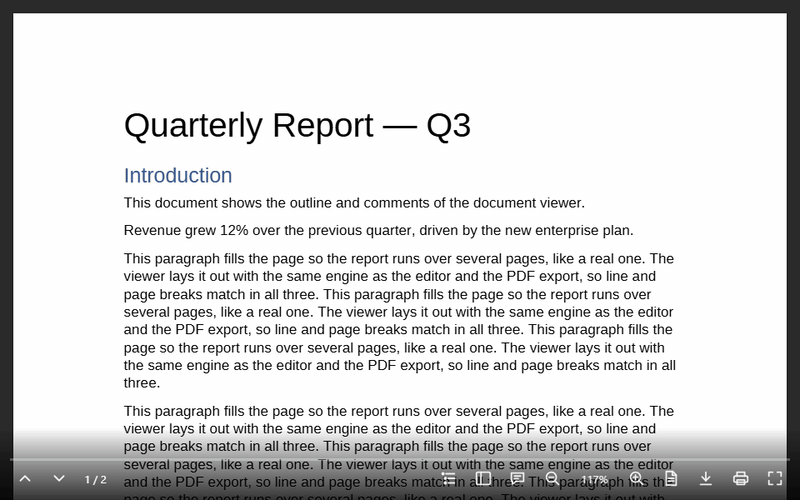

# @universal-office/document-viewer

The `<universal-document-viewer>` web component: a **read-only viewer for
.docx and .doc** files with layout faithful to Microsoft Word — the same
pagination, line breaks and page images as the editor and the PDF export,
because all three use the same layout engine.



- Print, Read and Web views, zoom (page width, whole page or a percentage)
- Side panel with page thumbnails and the document outline (headings)
- Comments panel linked to the highlighted text
- Selectable, searchable text (invisible text layer over the canvas)
- Download the original file or a PDF, print and full screen; PDF export
- Keyboard and screen-reader accessible; English and Portuguese UI

## Installation

```bash
npm install @universal-office/document-viewer
```

All the code is inside the package: one ES module plus a folder that must be
served next to it. Its only dependency is `@universal-office/font-files` (pinned to an exact
version), the open fonts.

| Path | What it is |
|---|---|
| `index.js` | The component (registers `<universal-document-viewer>` on import) |
| `chunks/` | Parts loaded on demand (hyphenation patterns, rare converters) |
| `@universal-office/font-files` | Open fonts (Liberation, Carlito, Caladea) used as metric-compatible substitutes (see [Fonts](#fonts)) |

```js
import '@universal-office/document-viewer';
```

```html
<universal-document-viewer src="/report.docx" fonts="/node_modules/@universal-office/font-files"
  style="display:block; height:100vh"></universal-document-viewer>
```

Give the element a size with CSS — it fills its box.

Already using the editor? `@universal-office/write` contains this same
component as a second entry, `@universal-office/write/viewer`, sharing its code
with the editor — no need for this package too.

## Attributes

| Attribute | Values | Description |
|---|---|---|
| `src` | URL | Document to fetch and show (same origin or CORS). Reloads when changed. |
| `fonts` | URL | Folder with the open fonts (the `@universal-office/font-files` package). Default: `../font-files/` relative to `index.js` — the sibling package in `node_modules/@universal-office/`, or the sibling folder when every package is copied to `<base>/<name>/`. Set it when the fonts are served from somewhere else, or when the component is bundled or loaded from a `blob:`/`data:` URL. Read once, on the first layout. |
| `view` | `print` (default) · `read` · `web` | Initial view. |
| `zoom` | `page-width` (default) · `page-fit` · number or `%` | Initial zoom, e.g. `125` or `125%` (10–800%). |
| `noselect` | boolean | Turns off text selection. |
| `nocontrols` | boolean | Removes the whole control bar. |
| `no<item>` | boolean | Removes one control: `nonav`, `nocounter`, `nooutline`, `nothumbnails`, `nocomments`, `nozoom`, `noview`, `nodownload`, `nodownloadpdf` (the Print button then prints directly, with no Save as PDF option), `noprint`, `nofullscreen`, `noprogress`. |
| `lang` | `en` · `pt` | UI language. Without it: Portuguese if the browser prefers it, otherwise English. |
| `theme` | `auto` (default) · `light` · `dark` | Light or dark UI. `auto` — or no attribute — follows the CSS `color-scheme` the element inherits from the page (see [Light and dark](#light-and-dark)); `light`/`dark` force it. |

## Methods

| Method | Description |
|---|---|
| `loadDocx(bytes: Uint8Array): Promise<void>` | Loads a .docx or .doc. Throws on an invalid file and keeps the current one. |
| `getPageCount()` · `getPageIndex()` | Page count and current page (0-based). |
| `goToPage(i, smooth = true)` | Scrolls to a page. |
| `getView()` · `setView('print' \| 'read' \| 'web')` | Current view. |
| `getZoom()` · `setZoom(spec)` | `spec` is `'page-width'`, `'page-fit'` or a factor (`1` = 100%, 0.1–8). `getZoom()` returns `{ spec, factor }`. |
| `getHeadings()` · `goToHeading(i)` | Outline: `{ level, text, page }[]`. |
| `getComments()` · `selectComment(id)` | Comments: `{ id, author, text, page }[]`. |
| `exportPdf(): Uint8Array` | PDF of the print layout. |
| `effectiveTheme` | `'light'` · `'dark'` — the UI theme in effect (getter). |
| `print()` · `download()` · `downloadPdf()` · `toggleFullscreen()` | Same as the control-bar buttons: Download saves the original file; Print opens a menu with **Print…** and **Save as PDF** (`downloadPdf()`, the PDF of the print layout). |

```js
const viewer = document.querySelector('universal-document-viewer');
const bytes = new Uint8Array(await (await fetch('/contract.docx')).arrayBuffer());
await viewer.loadDocx(bytes);
viewer.setZoom('page-fit');
```

## Plugins

The viewer takes the same plugins as `<universal-write>` (Quill's model): per
instance with `viewer.use(plugin)` / `viewer.unuse(id)`, or for every
instance with `UniversalDocumentViewerElement.register(plugin)` /
`unregister(id)` (connected instances get it right away; new ones on
connect; the same id again replaces it; a conflict in one instance is a
`console.warn`, never a failed connection). A plugin declares
`inlineRenderers` (painted over the fallback text of the content control,
exactly as in the editor) and `setup({ viewer })` (returns its cleanup).

| Method | Description |
|---|---|
| `use(plugin)` · `unuse(id)` · `pluginIds()` | Plugins of this instance. |
| `getLinks()` | Hyperlinks of the body in document order: `{ address }` or `{ anchor }` plus `text`. |
| `getCustomInlines(type?)` | Plugin inlines of the body (`{ type, data, fallbackText }`). |
| `goToBookmark(name)` | Scrolls to a bookmark; `false` if the document has no bookmark with that name. |
| `repaint()` | Repaints the pages (state read by a renderer changed). |

## Events

| Event | `detail` | When |
|---|---|---|
| `udv-loaded` | `{ pages }` | A document finished loading. |
| `udv-error` | `{ src, error }` | `src` could not be fetched or read. |
| `udv-page` | `{ index }` | The current page changed. |
| `udv-view` | `{ view }` | The view changed. |
| `udv-zoom` | `{ zoom, factor }` | The zoom changed. |
| `udv-heading` | `{ index, level, text, page }` | An outline entry was chosen. |
| `udv-comment` | `{ id, author, text }` | A comment was chosen. |
| `udv-download` | `{ bytes, filename }` | Download button. **Cancelable** — call `preventDefault()` to handle the file yourself. |
| `udv-download-pdf` | `{ pdf, filename }` | Save as PDF (Print menu). **Cancelable** — call `preventDefault()` to handle the PDF yourself. |
| `udv-print` | `{ pdf }` | Print button. **Cancelable** — handle printing yourself. |
| `udv-link-click` | `{ address, anchor, text, page }` | A hyperlink was clicked. **Cancelable** — without `preventDefault()`, `http`, `https` and `mailto` open in a new tab (`noopener,noreferrer`), bookmarks scroll into view and other schemes are ignored. |
| `udv-inline-click` | `{ type, data, fallbackText, page }` | A plugin inline was clicked. |
| `udv-plugin-added` · `udv-plugin-removed` | `{ id }` | Plugin lifecycle. |
| `udv-theme-change` | `{ theme }` | The UI theme in effect (`'light'` · `'dark'`) changed — the page's `color-scheme`, the OS (with `light dark`) or `theme`. |

## Side panel

Light DOM children with `slot="side"` (or `slot="side-start"`) are shown beside
the pages, at the full height of the viewer: the page area — with its control
bar — shrinks and refits its zoom, like the comments pane of Google Docs. The
host owns the panel (its own component in the light DOM, so the page's styles
apply), sets its width and shows or hides it; an empty or hidden slot takes no
space. The panel scrolls by itself; keys and the wheel in it never reach the
viewer (no page turns), it is outside full screen (which shows the pages only)
and outside printing, and it inherits the viewer's `color-scheme`. The
wrappers are `::part(side)` and `::part(side-start)`. Together with the
`<universal-write>` side panel and the bar kit's `createBarRow({ titlePlacement:
'above-menus' })`, a host keeps the same layout in edit and preview modes.

```html
<universal-document-viewer src="/policy.docx">
  <app-document-data slot="side" style="width: 320px"></app-document-data>
</universal-document-viewer>
```

## Light and dark

The viewer follows the **CSS `color-scheme` of its context** — the value it
inherits from the page, across the shadow DOM. All its colors (desk, side
panels, control bar, menus, thumbnails, comments) are `--u-color-*` tokens of
`@universal-material` with `light-dark()` fallbacks, so the switch is pure CSS
and live:

- `@universal-material` pages work as they are: `:root { color-scheme: light dark }`
  follows the OS and the `u-light` / `u-dark` classes set `color-scheme`; the
  viewer only looks at the resulting `color-scheme`, never at the classes.
- No `color-scheme` anywhere: the browser default (`normal` = light).
  `color-scheme: light dark` follows the OS.
- `theme="light"` / `theme="dark"` force it; `auto` or no attribute inherits.
- The page itself stays white (the document's paper), in both themes.

`effectiveTheme` and `udv-theme-change` report the theme in effect, read from
a probe in the shadow root (no polling, no class observers; everything is
released on disconnect).

**Earlier versions were always dark.** To keep that look, set
`theme="dark"` (or `color-scheme: dark` on an ancestor), or pin the colors
with the variables below.

## Styling

CSS custom properties. Each one first reads `--udv-<name>`, then the shared
`--uo-<name>` (one theme for both viewers). Like Google Docs and Drive, **one
background color** covers the desk around the pages, the side panels and the
control bar (which fades into it); only the page is different:

| Property | Default |
|---|---|
| `--udv-background` | `--u-color-surface-container-low` (`#f5f3f7` light / `#1b1b1f` dark): the one background |
| `--udv-web-background` | `#fff` (Web view) |
| `--udv-page-gap` | `16px` |
| `--udv-panel-bg` | side panels — `--udv-background` |
| `--udv-comment-highlight` | `#f5b400` |
| `--udv-focus-color` | `--u-color-primary` |
| `--udv-selection` | text-selection color |
| `--udv-controls-color` · `--udv-controls-size` · `--udv-controls-bg` · `--udv-controls-hover-bg` | `--u-color-on-surface` · `22px` · gradient into `--udv-background` · translucent ink |
| `--udv-progress-color` · `--udv-progress-track` · `--udv-progress-height` | `--u-color-primary` · translucent ink · `3px` |

Parts for `::part()`: `viewer`, `side`, `side-start`, `pages`, `page`, `nav-panel`, `nav-tab`,
`outline`, `outline-item`, `thumbnails`, `thumbnail`, `comments`, `comment`,
`menu`, `menu-option`, `controls`, `progress`, `progress-value`, `counter`,
`button` and `button-<name>` (`prev`, `next`, `outline`, `thumbnails`,
`comments`, `zoom-out`, `zoom-level`, `zoom-in`, `view`, `download`, `print`,
`fullscreen`).

```css
universal-document-viewer {
  --uo-controls-color: #ffd54f;
  --udv-background: #1e1e1e;
}
universal-document-viewer::part(button-download) { display: none; }
```

## Fonts

Fonts embedded in the document are used first. Other families are resolved,
in order, from: fonts the browser can see by name (installed or declared with
`@font-face`), then **metric-compatible open substitutes** from the `fonts`
folder (Calibri → Carlito, Cambria → Caladea, Arial → Liberation Sans, Times
New Roman → Liberation Serif, Courier New → Liberation Mono), then Liberation
Sans. The open fonts come in `@universal-office/font-files`, installed with
this package; serving its folder keeps line breaks right when the reader does
not have the Office fonts. The package also exports `FontResolver` for advanced
setups:

```js
import { FontResolver } from '@universal-office/document-viewer';
FontResolver.shared().configure({ baseUrl: '/assets/office-fonts' });
```

## Keyboard

| Keys | Action |
|---|---|
| Ctrl/⌘ `+` · `-` · `0` and Ctrl+wheel | Zoom in, out, reset (disabled by `nozoom`) |
| → ↓ PageDown Space / ← ↑ PageUp (Read view) | Next / previous screen |
| Home · End | First / last page |

## Formats

Input: `.docx`, `.doc` (Word 97–2003, converted in memory). Output: PDF
(`exportPdf`, `downloadPdf`), the original file (`download`).

## License

MIT. The fonts (`@universal-office/font-files`) are under the SIL OFL 1.1
and the Apache License 2.0.
